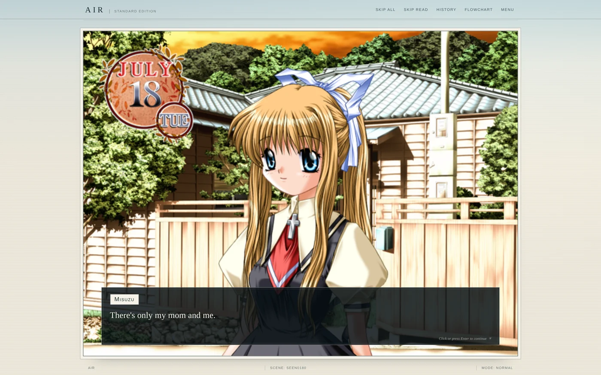

# AIR Web Player

An **experimental**, unofficial AIR Standard Edition browser player built with React and TypeScript. Bring your own compatible game data. This repository and the default build contain **no game assets**.

Includes a RealLive bytecode reader/runtime, G00/PDT image and NWA audio conversion, text and choices, save/load with autosave and JSON export/import, history, skip modes, gallery, and a story flowchart. It is not a complete or pixel-perfect replacement for the original engine. See [QA status and limitations](docs/QA.md).



*Early preview captured from the author's own legally-owned build. The repository
distributes no game data or asset files; this promotional screenshot is the only
game-derived image, is never loaded by the engine, and is not part of any build.*

## Try the asset-free demo

Use **Node.js 24.15+ LTS** (or Node 22.22.2+) and npm. No external converter is required.

```sh
npm ci
npm run dev:demo
```

Open the URL printed by Vite. The demo has synthetic text and choices, not the AIR story. To build a distributable demo:

```sh
npm run build
npm run preview
```

`npm run build` is always asset-free, **even when local assets exist**. It writes `dist/`. It never runs the converter or copies `.air-web-assets/`.

## Run your own game data

Obtain a compatible AIR Standard Edition installation lawfully. Copy its files into `AIR_SE/` beside `package.json`, retaining names and directory layout:

```text
AIR_SE/
  SEEN.txt
  GAMEEXE.INI
  G00/
  PDT/
  BGM/
  WAV/
  KOE/
  DAT/
```

Tested with the local Standard Edition dataset including rlBabel-style localized text and loose Ogg voice files. Other editions, patches, packed voice formats, and case-different filenames are not guaranteed compatible. Do not download game files from issue attachments or execute bundled EXE/DLL files to use this player.

```sh
npm run prepare:air
npm run dev
```

Preparation reads `AIR_SE/` and writes `.air-web-assets/`. It does **not delete originals or decoded media**. Existing converted media are reused; use a separate checkout when changing game versions to avoid stale conversions. `AIR_PREPARE_CLEAN=1` is deliberately refused. Preparation may take several minutes and requires several GB of free disk space. The tested output has around 26,000 media files and a ~128 MB uncompressed story manifest.

For an explicit asset-bearing build:

```sh
npm run build:game
npm run preview:game
```

This writes `dist-game/`. **Do not publish `dist-game/` to the source repository or attach it to a source-only GitHub release.** A manifest contains dialogue and decoded scripts, so excluding only images/audio is insufficient. Original EXE/DLL files and the local asset report are not copied into the game build.

For a packed deployment, run:

```sh
npm run pack:air
npm run pack:air:check
```

`dist-pack/` groups the media into a few hundred byte-range archives and splits the 128 MB story manifest into a small bootstrap, a compressed index, and per-scene files. It is also private and gitignored; see [Hosting](docs/HOSTING.md) for assembly and cache rules.

## Controls and saves

- Click the upper game stage or press Enter/Space: reveal text, then advance.
- Click a choice to select it. Tab/Enter activate focused buttons normally.
- Escape or right-click: open/close menu. H/PageUp: history.
- F5 quick saves to one rolling snapshot; F9 loads it. Quick save never touches the numbered slots.
- Hold Control over the game stage, or use Skip All / Skip Read. Opening a panel or losing focus stops skip.
- Menu: saves, loading/import, quick save/load, export, settings, CG gallery, music mode, fullscreen, previous choice, title.

Saves/settings are stored in browser IndexedDB, scoped to the site origin. Clearing site data removes them. Export saves before changing host/browser; exports can contain game dialogue. When IndexedDB is unavailable, the fallback is memory-only and is lost on reload. There is no cloud sync. Flowchart jumps are exploratory and do not reconstruct all route prerequisites.

**Autosave** keeps one rolling snapshot as you read, so a closed tab or a refresh resumes at the last line; **Continue** on the title screen uses it when no manual save exists, and the menu offers *Resume autosave*. It is stored separately from the quick save (F5/F9) and from numbered slots, so it can never overwrite a save you made deliberately. Toggle it under Settings → Saving.

## Hosting and contributing

- [Hosting guide](docs/HOSTING.md): static deployment, subpaths, bandwidth, authorized asset hosts.
- [Release checklist](docs/RELEASE.md): create a source-only package without touching local assets.
- [Contributing](CONTRIBUTING.md) and [security guidance](SECURITY.md).

```sh
npm run check
npm run release:check
npm run release:source
```

`release:source` creates a fresh allowlisted source folder under ignored `release/` plus a SHA-256 inventory beside it. It never recursively copies your working directory. Review that folder before creating your GitHub repository.

## License and rights

Player source is [MIT licensed](LICENSE). AIR game data, story, artwork, music, voices, trademarks, translation patches, and third-party software are **not** covered by that license. Dependencies retain their own licenses. This project is not affiliated with or endorsed by the original rights holders. Owning a copy does not automatically grant the right to redistribute or publicly host its contents. Asset hosts must obtain the necessary permissions independently; this repository supplies neither assets nor redistribution rights. Contributors must verify the provenance and licensing of any code they submit.
